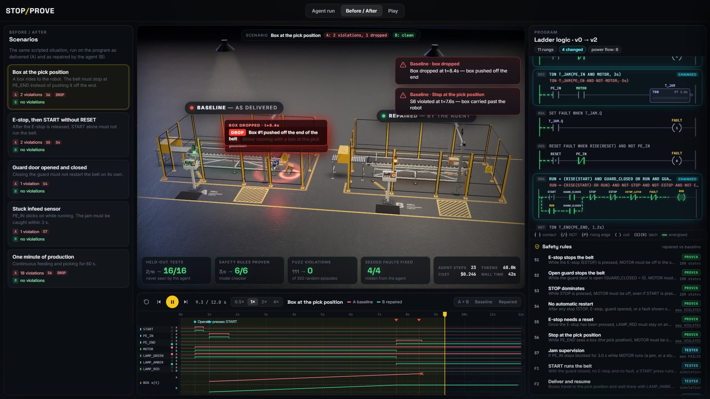

# STOP/PROVE

> **An agent that commissions PLC logic, and proves it's safe.** Built live at **[neatHack](https://neatlogs.com/hackathon)** (Oct 10–12, 2026) by team **LastCommit**. #neatHack

Every machine on a factory floor runs control logic that someone has to commission: test it, find the bugs, fix them, and sign it off. Today that happens on site, under time pressure, with real motors and real people nearby. The bugs that slip through are the dangerous kind. An E-stop clears itself without a reset. A belt restarts on its own when a guard door closes. A stuck sensor goes unnoticed.

STOP/PROVE does that commissioning job end to end, **before the logic touches a real machine**:

1. It gets a control program with **hidden, unlabelled faults**, plus the machine's operating rules.
2. It **tests** the program on a digital twin of the cell, reads the failures, and **runs its own experiments** to find root causes.
3. It **patches** the program in a restricted control language: small, reviewable edits that a validator checks.
4. It **proves** the safety rules with a model checker, across every reachable state and every possible input sequence. Passing the tests isn't enough.
5. It **recovers** when an action fails: rejected patches, regressions (rolled back) and tool crashes.
6. It **submits**, and an evaluation it never saw scores the repair: held-out tests, 300 randomized fuzz episodes and the proofs.

**Live demo:** https://mohammad-umar7.github.io/neathack-agent/ · **Video:** https://youtu.be/N1fPHoXPd6A · **Business plan:** [docs/business-plan](docs/business-plan/README.md) · **Traces:** [docs/traces](docs/traces/README.md)

## What you see in the demo

- **The cell:** a high-poly three.js digital twin with an infeed conveyor, photo-eyes, an interlocked guard door, an operator panel, a stack light and a pick gantry. Every frame comes straight from the simulator.
- **Agent run:** the agent's real steps, one at a time. Tests and counterexamples, patches and rollbacks, failures and recoveries. The ladder-logic view diffs every program version.
- **Before / After:** the delivered program and the repaired one side by side on the same scenario. On the left a box gets pushed off the end; on the right the belt stops at the robot.
- **Play:** a live digital twin. Press START, slam the E-stop, open the guard, jam a sensor, or edit a rung yourself and watch the safety monitors.

## Results

Real runs with `claude-sonnet-4.6` (neatHack LiteLLM proxy), traced in neatlogs. The held-out tests, fuzzing and proofs run after the agent submits.

| | Program as delivered | After the agent |
|---|---|---|
| Visible tests | 2 / 8 | 8 / 8 |
| **Held-out tests** (never shown to the agent) | 2 / 16 | **16 / 16** |
| Safety rules **proven** (S1–S6, every reachable state) | 3 / 6 | **6 / 6** |
| Fuzz episodes with a violation (300 random runs) | 111 / 300 | **0 / 300** |
| Hidden seeded faults fixed | 0 / 4 | **4 / 4** |
| Cost / wall time of the agent run (v2) | | $0.13 / 27 s |

- **Tests are not enough.** In 3 of 6 trials, the agent wrote a patch that passed all 8 tests but still broke a safety rule. The model checker caught every one before submission.
- **Improved from its traces.** The run records showed failed actions (rejected patches). After fixing the tool interface, failed actions per run fell from **1.17 to 0.00** and cost from $0.190 to $0.169 (6 trials each).
- **Recovers.** With a crash injected into the model checker, the agent works around it and still submits a proven repair; neatlogs flags the crash as an Execution Failed detection.

Details, raw data and screenshots: [docs/traces](docs/traces/README.md).



## How it works

```
                 ┌──────────────── agent loop (agent/loop.py) ────────────────┐
  operating ───▶ │  read_spec · read_program · run_tests · get_test_details   │
  rules (S1–S7)  │  simulate (own experiments) · prove · propose_patch        │
  program v0 ──▶ │  rollback · submit                                         │
                 └───────┬───────────────────────────────┬────────────────────┘
                         │                               │
              digital twin (agent/plc)          model checker (agent/plc/verify.py)
              PLC scan engine + conveyor        every reachable state × all 128 input
              plant + safety monitors           combinations per scan, abstract timers
                         │                               │
                         └──────────▶  evaluation the agent never sees  ◀──────────┘
                                       held-out tests · 300 fuzz episodes · proofs
                                       · hidden fault manifest (agent/plc/hidden.py)
```

- **Restricted control language** ([agent/plc/lang.py](agent/plc/lang.py)): assignments, SET/RESET latches, on-delay timers and rising edges, within 24 rungs, 4 timers and 12 contacts per rung. The agent can only change the program through validated patches of at most 4 edits.
- **Digital twin** ([agent/plc/engine.py](agent/plc/engine.py), [sim.py](agent/plc/sim.py)): a deterministic scan engine (0.1 s scan) and a conveyor plant in integer millimetres. The same simulator is ported to TypeScript for the browser, and [scripts/parity_check.py](scripts/parity_check.py) checks the two produce identical traces.
- **Proofs** ([agent/plc/verify.py](agent/plc/verify.py)): explicit-state model checking. All 7 inputs are free every scan, so stuck sensors and any operator behaviour are covered. Timers are abstracted, so a running timer may finish at any later scan, which makes a proven rule hold for every timer preset and every sequence length. A violation comes back as the shortest counterexample.
- **Hidden answer:** the agent gets the executable model and test results, never the fault labels or the held-out suite.

### The seeded faults (spoilers)

<details><summary>What the agent had to find</summary>

| Fault | Rung | Symptom |
|---|---|---|
| Missing E-stop reset | R02 | The E-stop latch clears on release; no RESET needed (violates S5) |
| Timing race at the pick position | R07/R08 | PE_END is debounced for 1.2 s, but the box reaches the end of the belt in 0.8 s, so it falls off (violates S6) |
| Unsupervised stuck sensor | R03 | The jam timer runs while the motor is OFF: a stuck PE_IN is never caught, and a waiting box raises a false alarm (violates S7) |
| Restart after the guard closes | R06 | Opening the guard doesn't drop run mode, so closing it restarts the belt (violates S4) |

</details>

## Built with

| Tool | How it's used |
|---|---|
| [neatlogs](https://neatlogs.com) | `neatlogs.init()` runs before the OpenAI client is imported, so every LLM call is captured; `@span(kind="WORKFLOW")` wraps each run and every tool call gets a `TOOL` span with inputs and outputs. neatlogs' automatic detections flag failed tool calls. Screenshots and the before/after numbers: [docs/traces](docs/traces/README.md). |
| [Entire](https://entire.io) | Recorded the Claude Code session that built this repo. Its commit hook froze in our git-worktree setup, so we linked the session with Entire's own recovery command (`entire session attach`): see the `Entire-Checkpoint:` trailer on [c929ee9](https://github.com/Mohammad-Umar7/neathack-agent/commit/c929ee9505309a2ac4bde6e597e8d0e6932a518f) and the `refs/entire/checkpoints/...` ref. |
| [cfo.ai](https://cfo.ai) | Ari, cfo.ai's AI CFO, rebuilt our plan as a 36-month model with base, upside, downside and no-seed scenarios: ARR $223k / $1.36M / $3.37M at months 12 / 24 / 36, gross margin 62% / 67% / 71%, about 24 months of runway on a $500k pre-seed ([screenshot](docs/evidence/cfo-ai-model.jpg), [plan](docs/business-plan/README.md)). |
| Claude (via the neatHack LiteLLM proxy) | The agent's model. |
| three.js | The digital twin (all CC0 assets from Poly Haven, see `web/public/assets/CREDITS.txt`). |

## Run it

```bash
uv sync
cp .env.example .env                                   # LLM_API_KEY (+ NEATLOGS_API_KEY for traces)
uv run python -m agent.run --variant v2 --manifest     # verified agent, exported to the viewer
uv run python -m agent.run --variant v1 --manifest     # naive first version, for the before/after
uv run python -m agent.run --variant v2 --chaos        # injected tool failure, to show recovery
uv run python -m scripts.check_cell                    # tests, fuzz and proofs on the baseline and a reference fix
cd web && npm install && npm run dev                   # the viewer at http://localhost:5173
```

## Repo map

| Path | What |
|---|---|
| `agent/plc/` | Language, scan engine, plant, monitors, simulator, tests, model checker, hidden scoring data |
| `agent/loop.py`, `agent/tools.py`, `agent/llm.py` | The agent: loop, tools, LLM backends |
| `agent/run.py`, `agent/evaluate.py` | Run, held-out evaluation, export to `web/public/data` |
| `web/` | The viewer: three.js digital twin (`src/scene`), UI (`src/ui`), browser simulator (`src/sim`) |
| `docs/` | Business plan, traces, build log |

## License

[MIT](LICENSE)
