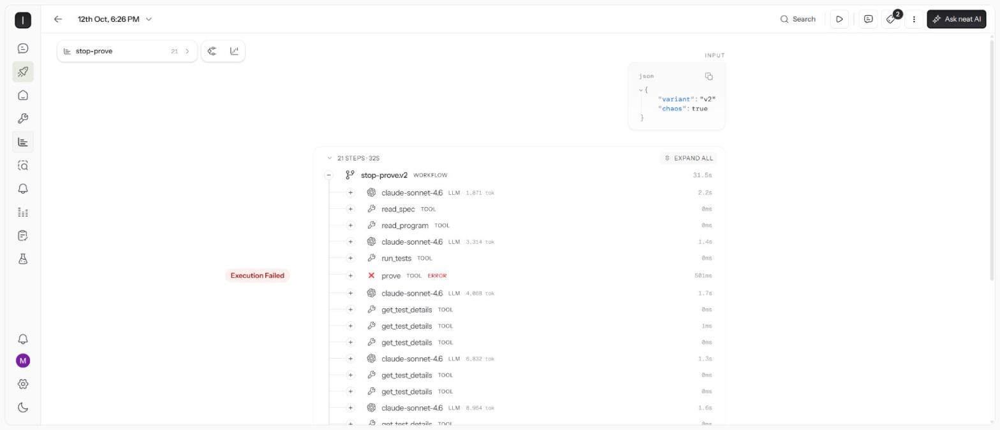
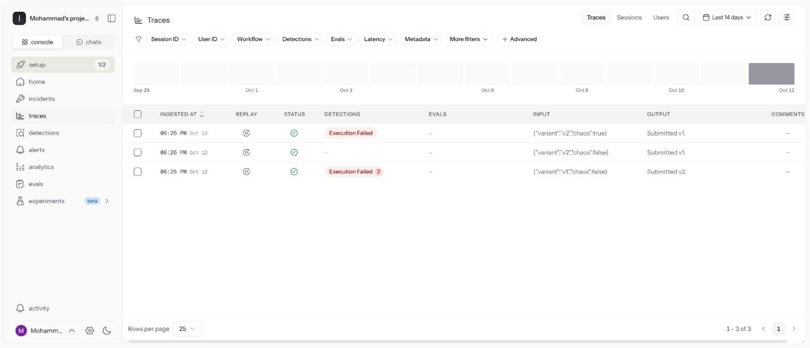

# Agent runs: before / after

All runs use `claude-sonnet-4.6` through the neatHack LiteLLM proxy and are traced in **neatlogs** (project `b546a6a0-fa85-4ff0-8f6c-517c1cf82964`). Every run records each LLM call and tool call with tokens, latency and cost: the workflow span wraps the run and each tool call gets a tool span (`agent/run.py`). The held-out tests, the 300 fuzz episodes and the proofs run after the agent submits; the agent never sees them.

## 1. The program: as delivered vs after the agent

| | Program as delivered | After agent v2 |
|---|---|---|
| Visible tests | 2/8 | 8/8 |
| Held-out tests (never shown to the agent) | 2/16 | 16/16 |
| Safety rules proven (S1–S6, every reachable state) | 3/6 | 6/6 |
| Fuzz episodes with a violation (300 random runs) | 111/300 | 0/300 |
| Hidden seeded faults fixed | 0/4 | 4/4 |

## 2. Improving the agent from its traces

The first traced runs showed the agent wasting steps on **failed actions**: patches rejected because the model wrote `#` comments inside rungs, sent more than four edits, inserted a second rung for a coil instead of replacing it, or set a timer preset to 0 s to "disable" it. We changed the tool interface (the parser keeps a trailing `# comment` as the rung comment; the patch tool says how to replace, how to remove a timer, and to split large changes) and re-ran six independent trials of each agent.

| Agent v2, 6 runs each | Before the fix | After the fix |
|---|---|---|
| Failed actions per run | 1.17 | **0.00** |
| Steps per run | 18.8 | **17.3** |
| Input tokens per run | 46,816 | **43,930** |
| Cost per run | $0.190 | **$0.169** |
| Fully correct submissions | 6/6 | 6/6 |

Raw data: [`trials-before.json`](trials-before.json), [`trials.json`](trials.json).

## 3. Why the proofs matter

In **3 of 6** v2 runs after the fix, the agent produced a patch that **passed all 8 visible tests while a safety rule was still violated** (for example S4, the belt restarting by itself after the guard closes). Only the model checker caught it; the agent read the counterexample, patched again, and submitted once all six rules were proven. A test-only workflow would have stopped at the first patch.

## 4. Naive v1 vs verified v2

Claude Sonnet 4.6 is strong enough that the naive agent (tests only, pass/fail answers, no model checker) also repaired this cell in every trial. The difference is what the agent *knows* when it submits: v1 submits when the tests pass and cannot tell whether the safety rules hold; v2 submits only after the proofs pass.

| 6 runs each, after the fix | v1 naive | v2 verified |
|---|---|---|
| Fully correct submissions | 6/6 | 6/6 |
| Submitted with the safety rules proven by the agent itself | 0/6 (no checker) | 6/6 |
| Runs where a test-passing patch was still unsafe | 0/6 | 3/6 |
| Steps / cost per run | 15.0 / $0.119 | 17.3 / $0.169 |

## 5. Failure and recovery

`v2-recovery` injects a crash into the first model-checker call (exit code 137). neatlogs flags it automatically as an **Execution Failed** detection on the `prove` tool span; the agent noticed the failed action, kept investigating through the test details, and still submitted a fully proven repair. The first recovery run (before the trace-driven fix) also hit two rejected patches and recovered from both; it is kept in the viewer as "first run".

| Traced runs (neatlogs + the viewer) | v1-naive | v2-verified | v2-recovery | v2-recovery, first run |
|---|---|---|---|---|
| Held-out tests | 16/16 | 16/16 | 16/16 | 16/16 |
| Rules proven | 6/6 | 6/6 | 6/6 | 6/6 |
| Failed actions / recoveries | 2 / 1 | 0 / 0 | 1 / 1 | 3 / 2 |
| Steps / LLM calls | 19 / 9 | 15 / 6 | 19 / 7 | 23 / 9 |
| Cost | $0.17 | $0.13 | $0.17 | $0.23 |

